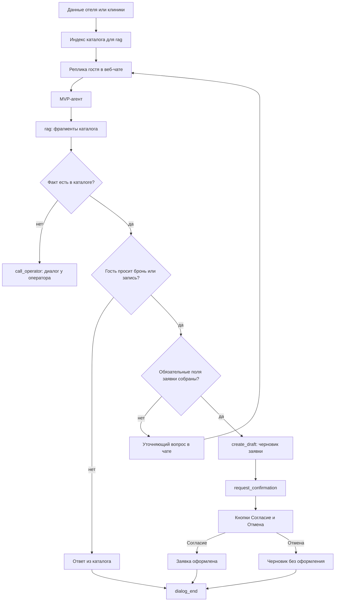

# ML System Design Doc

## Дизайн ML системы — Universal Consultant, MVP, итерация 1

Итерация — работы до пилота. Первый заказчик пилота — бизнес из гостиничного сегмента. Исполнитель — компания, которая делает IT- и AI-решения для других бизнесов.

### 1. Цели и предпосылки

#### 1.1. Зачем идем в разработку продукта

**Бизнес-цель.** У исполнителя уже были заказы на диалоговых консультантов под конкретный бизнес, и каждый раз решение собиралось заново. Сейчас пришёл заказ из гостиничного сегмента: автоматизировать типовую работу колл-центра, который консультирует гостей и собирает бронь. Цель итерации — закрыть этот заказ универсальным консультантом. Тот же агент и тот же набор инструментов должны мочь удовлетворить любого следующего заказчика на данных другого домена без доработок. Для исполнителя это снижает стоимость следующего внедрения. Для отеля это снимает с колл-центра повторяющиеся консультации и ручной сбор заявки.

**Почему станет лучше, чем сейчас.** Под каждого заказчика разрабатывается свой бот или жёсткий сценарий. Для удовлетворения потребности новых заказчиков исполнитель только меняет данные, а не код агента. Это ведет к экономии на разработку.

**Успех итерации для бизнеса.** Итерация успешна, если один и тот же агент проходит демонстрацию на двух доменах. Первый домен — один отель, это текущий заказ. Второй — запись на приём в клинике. На проверочных диалогах консультант не называет номера, услуги и цены вне каталога. Заявка остаётся черновиком, пока клиент явно не согласился её оформить.

#### 1.2. Бизнес-требования и ограничения

**Бизнес-требования.** Заказчик пилота — один отель. Его колл-центр консультирует гостей по номерам и услугам и собирает бронь. В этой итерации агент забирает типовой диалог, а не весь колл-центр.

1. Гость задаёт вопросы о номерах и услугах свободным русским языком в веб-чате и получает ответ только по каталогу отеля.
2. Агент собирает черновик брони и оформляет заявку только после явного согласия гостя.
3. Оператор видит оформленную заявку. Если вопрос вне каталога или агент не уверен в ответе, диалог передаётся оператору.
4. Для исполнителя отдельно: тот же агент и те же инструменты проводят запись на приём в клинике после загрузки каталога и полей клиники.

**Бизнес-ограничения.**

- Язык диалога — русский.
- Канал — только текстовый веб-чат.
- Заявка не оформляется, пока клиент не нажал «Согласие». Кнопки согласия и отмены появляются, когда агент вызывает инструмент подтверждения. Отмена заявку не оформляет.
- Вопрос вне каталога и неуверенный ответ агента уходят оператору, а не закрываются догадкой.
- Пилот — внутренняя демонстрация заказчику на подготовленных сценариях, без живых гостей и без подмены текущего колл-центра.

**Что ожидаем от этой итерации.** Демонстрацию отелю: веб-чат доводит типовой диалог колл-центра до оформленной заявки либо до передачи оператору. Следом тот же агент на данных клиники показывает, что смена домена не требует доработок в агенте.

**Как модель входит в текущий процесс.** Сейчас гость пишет в чат колл-центра, оператор консультирует и вручную собирает бронь. В пилоте этот процесс не отключается. На демонстрации заказчик проходит сценарии гостя в веб-чате. Агент отвечает по загруженному каталогу, собирает поля брони и оставляет заявку черновиком. Когда данных достаточно, он вызывает инструмент подтверждения: в чате появляются кнопки согласия и отмены. Заявка оформляется только после согласия. Оператор в сценарии получает готовую заявку или перехват. Второй прогон повторяет те же шаги для записи на приём: другие сущности и поля, те же правила согласия и эскалации.

**Успешный пилот и развитие.** Пилот успешен, если проходят три группы сценариев.

- Отель: вопрос о номере или услуге, ответ из каталога, сбор полей, отказ оформить заявку без нажатия «Согласие», оформление после согласия, заявка видна оператору.
- Отель: вопрос вне каталога или неуверенный ответ — передача оператору, без выдуманной цены или номера.
- Клиника: после загрузки каталога и полей клиники тот же агент доводит диалог до записи на приём с теми же правилами.

Экономический ориентир — текущий колл-центр, где оператор закрывает каждый чат. Гипотеза следующей итерации, не критерий этого пилота: агент сможет сам закрыть заметную долю диалогов, порядка 70%. Эта доля не равна такому же сокращению расходов. Экономия зависит от того, какую часть времени оператора занимают закрытые диалоги, и от времени на разбор передач. На ручной демонстрации без живых гостей долю не измеряем.

Дальше, не в этой итерации: живые гости в веб-чате, оплата, запись брони во внутреннюю систему отеля.

#### 1.3. Что входит в скоуп проекта/итерации, что не входит

**Закрываем в этой итерации.**

- Консультация гостя одного отеля по каталогу в текстовом веб-чате на русском языке.
- Черновик брони и оформление заявки только после явного согласия.
- Передача диалога оператору, если вопрос вне каталога или агент не уверен в ответе.
- Тот же агент и те же инструменты для записи на приём в клинике после загрузки её каталога и полей заявки.
- Ручная демонстрация этих сценариев заказчику. Отдельный прогон диалогов командой в эту итерацию не входит.

**Не закрываем.**

- Живых гостей и подмену текущего колл-центра.
- Оплату и запись заявки во внутреннюю систему отеля или клиники.
- Рабочее место оператора: очередь, статусы, историю смен.
- Обучение своей модели и дообучение на диалогах. Берём готовую языковую модель и подключаем к ней инструменты.
- Медицинские советы. В клинике агент только помогает выбрать услугу и записаться на приём.

#### 1.4. Предпосылки решения

Классический горизонт прогноза здесь не нужен. Бизнес просит не предсказать спрос, а провести один диалог до заявки. Единица решения — реплика клиента и одна заявка: бронь номера или запись на приём. Пересчитывать модель по расписанию не требуется: факты меняются, когда заказчик загружает новые данные.

**Данные заказчика** — единственный источник фактов о номерах, услугах и ценах. Заказчик передаёт их системе при подключении. В них четыре части.

- Каталог: название, описание, цена и свойства номера или услуги.
- Поля заявки, которые агент обязан собрать. Для отеля это имя, телефон, даты и число гостей. Для клиники набор полей свой.
- Тип оформления: бронь на дату или заказ.
- Короткий текст правил домена: что агенту можно обещать, а что нельзя.

Если факта нет в этих данных, агент не достраивает его общими знаниями модели и не ходит на сайт заказчика. Он говорит, что в каталоге этого нет, и передаёт диалог оператору.

Учебные данные отеля и клиники собираем мы по структуре, согласованной с заказчиком. Боевой выгрузки прайса отеля в этой итерации нет.

Модель — готовая языковая, без дообучения. Устойчивая часть системы — инструменты: поиск по каталогу, карточка позиции, черновик заявки, запрос подтверждения, передача оператору. Смена заказчика меняет каталог, поля и правила, а не эти инструменты.

Подтверждение устроено так. Когда полей достаточно, агент вызывает инструмент подтверждения. Вызов открывает во фронтенде кнопки согласия и отмены. Оформленной заявка становится только после согласия. До этого она черновик. Отмена её не оформляет. Реплика «ок» в чате сама по себе согласием не считается.

### 2. Методология

#### 2.1. Постановка задачи

Техническая задача — диалоговый агент на готовой языковой модели с инструментами. Это не прогноз спроса и не отдельная модель ранжирования. Агент ведёт один текстовый чат на русском языке, отвечает по загруженным данным заказчика и заканчивает диалог одним из трёх исходов: оформленная заявка, передача оператору, завершение без заявки.

Сравниваем два уровня.

Экономический бейзлайн — колл-центр, в котором оператор закрывает 100% чатов. Стоимость считается от времени операторов. Гипотеза следующей итерации: если агент закроет часть диалогов сам, нагрузка на операторов снизится. Пример порядка — около 70% диалогов. В процент экономии его не переводим: неизвестно, какую долю времени занимают эти диалоги и сколько времени уйдёт на разбор передач. В этой итерации живого потока нет, гипотезу не проверяем.

Технический бейзлайн — агент с тремя инструментами: `rag`, `call_operator`, `dialog_end`. Он ищет ответ в загруженных данных, передаёт диалог оператору или завершает его. Собрать поля заявки и открыть кнопку согласия он не может, поэтому диалог, которому нужна бронь или запись, чаще заканчивается вызовом `call_operator`.

MVP оставляет эти три инструмента и добавляет инструменты оформления заявки. На одном и том же наборе демонстрационных диалогов доля диалогов без вызова `call_operator` у MVP должна быть выше, чем у бейзлайна. Для этой итерации достаточно показать разницу на ручной демонстрации. Целевые 70% к ней не относятся.

Диалог считаем автоматизированным, если в нём не вызывался `call_operator`. Вызов `dialog_end` для этого не обязателен. Передача оператору автоматизацией не считается. Оформленная заявка и просто закрытый вопрос без заявки оба идут в эту долю, если оператора не звали.

#### 2.2. Блок-схема решения

У бейзлайна и MVP общий вход: данные отеля или клиники и текстовый веб-чат. Дальше схемы расходятся набором инструментов. Модель не обучается. Индекс для `rag` строится из загруженного каталога.

На демонстрации один и тот же гостевой сценарий прогоняется дважды. Пример отеля: «номер на двоих с завтраком дешевле N на следующие выходные». Бейзлайн может ответить ценой из каталога, но бронь собирает только через `call_operator`. MVP добирает обязательные поля заявки, создаёт черновик и открывает кнопки согласия. Клиника проходит по тем же схемам: другие услуги и другие поля, код инструментов тот же.

Доля автоматизации на этих прогонах — доля диалогов без `call_operator`. Она не равна доле оформленных заявок: отмена на кнопке оставляет черновик и оператора не вызывает, такой диалог автоматизирован, но заявка не оформлена.

**Бейзлайн.** Инструменты: `rag`, `call_operator`, `dialog_end`.

**MVP.** Те же три инструмента плюс `create_draft` и `request_confirmation`.

