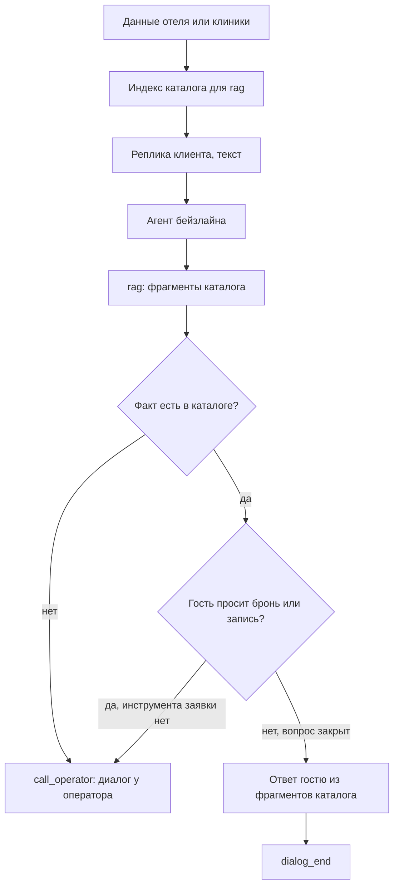

# ML System Design Doc

## Дизайн ML системы — Universal Consultant, MVP, итерация 1

Итерация — работы до пилота. Первый заказчик пилота — бизнес из гостиничного сегмента. Исполнитель — компания, которая делает IT- и AI-решения для других бизнесов.

### 1. Цели и предпосылки

#### 1.1. Зачем идем в разработку продукта

**Бизнес-цель.** Продукт — надстройка над готовой языковой моделью: агент, инструменты и правила поверх LLM. Надстройка не привязана к одному каналу. В технической поддержке она работает как обычный текстовый агент. В колл-центре она встаёт в пайплайн STT → LLM → TTS: речь клиента переводится в текст, надстройка ведёт диалог, ответ озвучивается. У исполнителя уже были заказы на диалоговых консультантов под конкретный бизнес, и каждый раз решение собиралось заново. Сейчас пришёл заказ из гостиничного сегмента: автоматизировать типовые консультации и сбор брони. Цель итерации — закрыть этот заказ той же надстройкой. Тот же агент и тот же набор инструментов должны мочь удовлетворить любого следующего заказчика на данных другого домена без доработок. Для исполнителя это снижает стоимость следующего внедрения. Для отеля это снимает повторяющиеся консультации и ручной сбор заявки — в чате поддержки или в голосовом пайплайне колл-центра.

**Почему станет лучше, чем сейчас.** Под каждого заказчика разрабатывается свой бот или жёсткий сценарий. Для удовлетворения потребности новых заказчиков исполнитель только меняет данные, а не код агента. Это ведет к экономии на разработку.

**Успех итерации для бизнеса.** Итерация успешна, если один и тот же агент проходит демонстрацию на двух доменах. Первый домен — один отель, это текущий заказ. Второй — запись на приём в клинике. На проверочных диалогах консультант не называет номера, услуги и цены вне каталога. Заявка остаётся черновиком, пока клиент явно не согласился её оформить.

#### 1.2. Бизнес-требования и ограничения

**Бизнес-требования.** Заказчик пилота — один отель. Он консультирует гостей по номерам и услугам и собирает бронь. Система, которой закрываем заказ, — надстройка для LLM. В техподдержке это обычный агент в чате. В колл-центре тот же агент стоит в пайплайне STT–LLM–TTS. В этой итерации агент забирает типовой диалог, а не всю линию поддержки и не весь колл-центр.

1. Гость задаёт вопросы о номерах и услугах свободным русским языком и получает ответ только по каталогу отеля. В пилоте реплика приходит текстом: из чата техподдержки или как текст после STT.
2. Агент собирает черновик брони и оформляет заявку только после явного согласия гостя.
3. Оператор видит оформленную заявку. Если вопрос вне каталога или агент не уверен, диалог передаётся оператору. «Не уверен» значит, что у агента нет информации, инструкций или средств для выполнения действия: факта нет в данных заказчика, в правилах домена нет указания, как поступить, или среди инструментов нет того, которым действие выполняется.
4. Для исполнителя отдельно: тот же агент и те же инструменты проводят запись на приём в клинике после загрузки каталога и полей клиники.

**Бизнес-ограничения.**

- Язык диалога — русский.
- Канал задаёт обвязка вокруг надстройки, а не сама надстройка. В техподдержке агент принимает текст напрямую. В колл-центре текст приходит из STT, ответ уходит в TTS. В этой итерации проверяем текстовый вход. Распознавание и синтез речи в итерацию не входят.
- Заявка не оформляется, пока клиент не нажал «Согласие». Кнопки согласия и отмены появляются, когда агент вызывает инструмент подтверждения. Отмена заявку не оформляет.
- Вопрос вне каталога и случай, когда агент не уверен, уходят оператору и не закрываются догадкой. Неуверенность — отсутствие информации, инструкций или средств для действия.
- Пилот — внутренняя демонстрация заказчику на подготовленных сценариях, без живых гостей и без подмены текущей линии поддержки или колл-центра.

**Что ожидаем от этой итерации.** Демонстрацию отелю: надстройка доводит типовой диалог до оформленной заявки либо до передачи оператору. Следом тот же агент на данных клиники показывает, что смена домена не требует доработок в агенте.

**Как модель входит в текущий процесс.** Сейчас оператор консультирует и вручную собирает бронь: в чате техподдержки или на звонке колл-центра. В пилоте этот процесс не отключается. На демонстрации заказчик проходит сценарии гостя текстом. Для колл-центра этот текст — середина пайплайна STT–LLM–TTS, для техподдержки — реплика чата; агент в обоих случаях один. Агент отвечает по загруженному каталогу, собирает поля брони и оставляет заявку черновиком. Когда данных достаточно, он вызывает инструмент подтверждения: появляются кнопки согласия и отмены. Заявка оформляется только после согласия. Оператор в сценарии получает готовую заявку или перехват. Второй прогон повторяет те же шаги для записи на приём: другие сущности и поля, те же правила согласия и эскалации.

**Успешный пилот и развитие.** Пилот успешен, если проходят три группы сценариев.

- Отель: вопрос о номере или услуге, ответ из каталога, сбор полей, отказ оформить заявку без нажатия «Согласие», оформление после согласия, заявка видна оператору.
- Отель: вопрос вне каталога или агент не уверен — нет информации, инструкций или средств для действия — передача оператору, без выдуманной цены или номера.
- Клиника: после загрузки каталога и полей клиники тот же агент доводит диалог до записи на приём с теми же правилами.

Экономический ориентир — линия, где оператор закрывает каждое обращение, в чате техподдержки или в колл-центре. Гипотеза следующей итерации, не критерий этого пилота: агент сможет сам закрыть заметную долю диалогов, порядка 70%. Эта доля не равна такому же сокращению расходов. Экономия зависит от того, какую часть времени оператора занимают закрытые диалоги, и от времени на разбор передач. На живом потоке долю в этой итерации не измеряем. Сравнение бейзлайна и MVP считаем на фиксированном наборе запросов, см. п. 2.1.

Дальше, не в этой итерации: живые гости в чате техподдержки и в голосовом пайплайне колл-центра, оплата, запись брони во внутреннюю систему отеля.

#### 1.3. Что входит в скоуп проекта/итерации, что не входит

**Закрываем в этой итерации.**

- Консультация гостя одного отеля по каталогу на русском языке. Вход — текст: реплика чата техподдержки или текст после STT.
- Черновик брони и оформление заявки только после явного согласия.
- Передача диалога оператору, если вопрос вне каталога или агент не уверен. Неуверенность — нет информации, инструкций или средств для выполнения действия.
- Тот же агент и те же инструменты для записи на приём в клинике после загрузки её каталога и полей заявки.
- Демонстрация этих сценариев заказчику и сравнение бейзлайна с MVP на фиксированных 20 запросах, каждый по 3 раза (п. 2.1).

**Не закрываем.**

- Живых гостей и подмену текущей линии поддержки или колл-центра.
- Обвязку STT и TTS. Пайплайн колл-центра рассчитан на STT–LLM–TTS, в этой итерации проверяем агента на тексте.
- Оплату и запись заявки во внутреннюю систему отеля или клиники.
- Рабочее место оператора: очередь, статусы, историю смен.
- Обучение своей модели и дообучение на диалогах. Берём готовую языковую модель и подключаем к ней инструменты.
- Медицинские советы. В клинике агент только помогает выбрать услугу и записаться на приём.

#### 1.4. Предпосылки решения

Классический горизонт прогноза здесь не нужен. Бизнес просит не предсказать спрос, а провести один диалог до заявки. Единица решения — реплика клиента и одна заявка: бронь номера или запись на приём. Пересчитывать модель по расписанию не требуется: факты меняются, когда заказчик загружает новые данные.

**Данные заказчика** — единственный источник фактов о номерах, услугах и ценах. Заказчик передаёт их системе при подключении. В них четыре части.

- Каталог: название, описание, цена и свойства номера или услуги.
- Поля заявки, которые агент обязан собрать. Для отеля это имя, телефон, даты и число гостей. Для клиники набор полей свой.
- Тип оформления: бронь на дату или заказ.
- Короткий текст правил домена: что агенту можно обещать, а что нельзя.

Если у агента нет информации, инструкций или средств для выполнения действия, он не закрывает его догадкой и не достраивает факт общими знаниями модели. Нет информации — факта нет в данных заказчика, и агент не ищет его на сайте заказчика. Нет инструкций — в правилах домена не сказано, как поступить. Нет средств — среди инструментов нет того, которым действие выполняется. Такой случай в требованиях назван «агент не уверен»: диалог передаётся оператору.

Учебные данные отеля и клиники собираем мы по структуре, согласованной с заказчиком. Боевой выгрузки прайса отеля в этой итерации нет.

Модель — готовая языковая, без дообучения. Устойчивая часть системы — инструменты: поиск по каталогу, карточка позиции, черновик заявки, запрос подтверждения, передача оператору. Смена заказчика меняет каталог, поля и правила, а не эти инструменты.

Подтверждение устроено так. Когда полей достаточно, агент вызывает инструмент подтверждения. Вызов открывает во фронтенде кнопки согласия и отмены. Оформленной заявка становится только после согласия. До этого она черновик. Отмена её не оформляет. Реплика «ок» в чате сама по себе согласием не считается.

### 2. Методология

#### 2.1. Постановка задачи

Техническая задача — диалоговый агент как надстройка над готовой языковой моделью с инструментами. Это не прогноз спроса и не отдельная модель ранжирования. Агент принимает текст на русском языке — реплику чата техподдержки или текст из STT в пайплайне колл-центра — отвечает по загруженным данным заказчика и заканчивает диалог одним из трёх исходов: оформленная заявка, передача оператору, завершение без заявки.

Сравниваем два уровня.

Экономический бейзлайн — процесс, в котором оператор закрывает 100% обращений: чат техподдержки или звонок в колл-центре. Стоимость считается от времени операторов. Гипотеза следующей итерации: если агент закроет часть диалогов сам, нагрузка на операторов снизится. Пример порядка — около 70% диалогов. В процент экономии его не переводим: неизвестно, какую долю времени занимают эти диалоги и сколько времени уйдёт на разбор передач. В этой итерации живого потока нет, гипотезу не проверяем.

Технический бейзлайн — агент с тремя инструментами: `rag`, `call_operator`, `dialog_end`. Он ищет ответ в загруженных данных, передаёт диалог оператору или завершает его. Собрать поля заявки и открыть кнопку согласия он не может, поэтому запрос на бронь или запись заканчивается вызовом `call_operator`.

MVP оставляет эти три инструмента и добавляет инструменты оформления заявки.

**Основная бизнес-метрика — автоматизация.** Диалог автоматизирован, если в нём не вызывался `call_operator`. Вызов `dialog_end` для этого не обязателен. Передача оператору автоматизацией не считается. Оформленная заявка и закрытый справочный вопрос без заявки оба входят в долю, если оператора не звали. С технической точки зрения автоматизация показывает, что агенту хватает инструментов, чтобы довести запрос клиента до исхода без оператора. Целевые 70% относятся к гипотезе следующей итерации на живом потоке и к этому сравнению не относятся.

**`action_accuracy` косвенно влияет на автоматизацию.** Её считаем на синтетическом датасете. Для каждого запроса задана эталонная последовательность действий. `action_accuracy` — доля правильно выполненных действий в этой последовательности: нужный инструмент и аргументы, согласованные с запросом. Связь с бизнес-метрикой такая. Верный шаг продвигает запрос к ответу из каталога или к оформлению заявки, и диалог остаётся автоматизированным. Ошибка в последовательности — пропуск шага, вызов не того инструмента или неверные аргументы — обрывает ход, которым запрос закрывается без оператора. Агент вызывает `call_operator`, и автоматизация падает. Автоматизация фиксирует исход диалога. `action_accuracy` фиксирует правильность шагов внутри и тем самым показывает, за счёт чего автоматизация держится. Одну метрику другой не подменяем.

**Сравнение бейзлайна и MVP.** Фиксируем 20 клиентских запросов: 10 справочных вопросов и 10 запросов на бронирование. Каждый из 20 прогоняем 3 раза. Повтор заложен из-за самой сущности GenAI: ответы и выбор инструментов недетерминированы, три прогона дают более точную оценку метрик, чем один.

На справочных вопросах ожидаем полную автоматизацию и у бейзлайна, и у MVP. Ответ находится через `rag`, инструментов заявки не требуется, `call_operator` не вызывается.

На бронировании ожидаем повышенную автоматизацию у MVP: инструменты заявки доводят диалог до подтверждения без оператора. Бейзлайн провести бронирование не может и вызывает `call_operator`.

#### 2.2. Блок-схема решения

У бейзлайна и MVP общий вход: данные отеля или клиники и текст реплики. Текст приходит из чата техподдержки или из STT в пайплайне колл-центра STT–LLM–TTS. Дальше схемы расходятся набором инструментов. Модель не обучается. Индекс для `rag` строится из загруженного каталога.

Сравнение — те же 20 запросов, каждый по 3 раза (п. 2.1): 10 справочных и 10 на бронирование. На справочных оба варианта отвечают через `rag` и не вызывают оператора. На бронировании бейзлайн вызывает `call_operator`, MVP добирает обязательные поля заявки, создаёт черновик и открывает кнопки согласия. Пример запроса на бронь: «номер на двоих с завтраком дешевле N на следующие выходные». Клиника проходит по тем же схемам: другие услуги и другие поля, код инструментов тот же.

Доля автоматизации на этих прогонах — доля диалогов без `call_operator`. Она не равна доле оформленных заявок: отмена на кнопке оставляет черновик и оператора не вызывает, такой диалог автоматизирован, но заявка не оформлена.

**Бейзлайн.** Инструменты: `rag`, `call_operator`, `dialog_end`.

**MVP.** Те же три инструмента плюс `create_draft` и `request_confirmation`.

