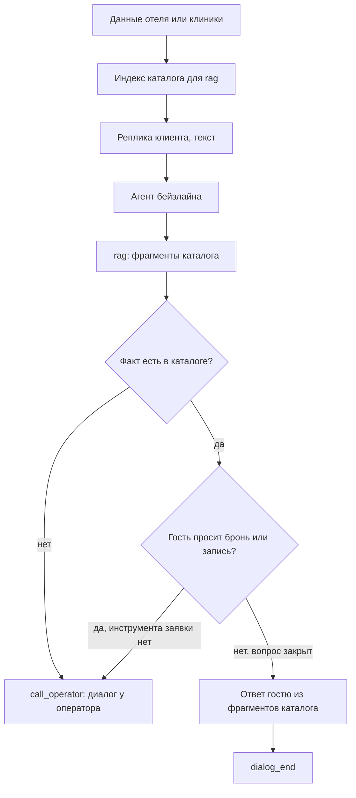
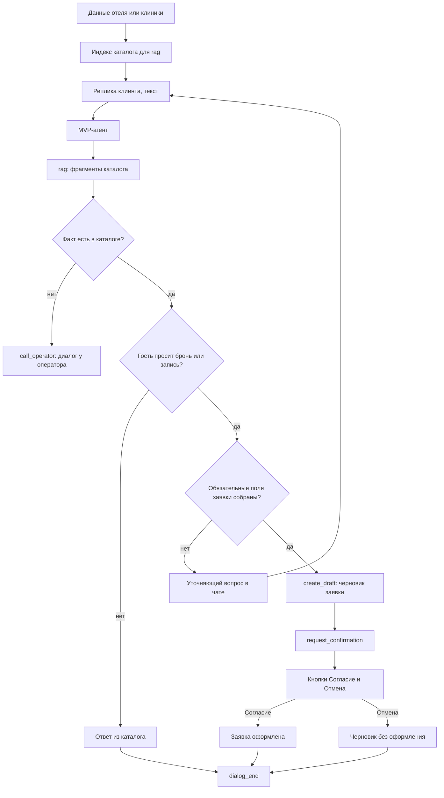

# ML System Design Doc

## Дизайн ML системы — Universal Consultant, MVP, итерация 1

Итерация — работы до пилота. Первый заказчик пилота — бизнес из гостиничного сегмента. Исполнитель — компания, которая делает IT- и AI-решения для других бизнесов.

### 1. Цели и предпосылки

#### 1.1. Зачем идем в разработку продукта

**Бизнес-цель.** Продукт — надстройка над готовой языковой моделью: агент, инструменты и правила поверх LLM. Надстройка не привязана к одному каналу. В технической поддержке она работает как обычный текстовый агент. В колл-центре она встаёт в пайплайн STT → LLM → TTS: речь клиента переводится в текст, надстройка ведёт диалог, ответ озвучивается. У исполнителя уже были заказы на диалоговых консультантов под конкретный бизнес, и каждый раз решение собиралось заново. Сейчас пришёл заказ из гостиничного сегмента: автоматизировать типовые консультации и сбор брони. Цель итерации — закрыть этот заказ той же надстройкой. Тот же агент и тот же набор инструментов должны мочь удовлетворить любого следующего заказчика на данных другого домена без доработок. Для исполнителя это снижает стоимость следующего внедрения. Для отеля это снимает повторяющиеся консультации и ручной сбор заявки — в чате поддержки или в голосовом пайплайне колл-центра.

**Почему станет лучше, чем сейчас.** Под каждого заказчика разрабатывается свой бот или жёсткий сценарий. Для удовлетворения потребности новых заказчиков исполнитель только меняет данные, а не код агента. Это ведет к экономии на разработку.

**Успех итерации для бизнеса.** Итерация успешна, если один и тот же агент проходит демонстрацию на двух доменах. Первый домен — один отель, это текущий заказ. Второй — запись на приём в клинике. На проверочных диалогах консультант не называет номера, услуги и цены вне каталога. Заявка остаётся черновиком, пока клиент явно не согласился её оформить.

#### 1.2. Бизнес-требования и ограничения

**Бизнес-требования.** Заказчик пилота — один отель. Он консультирует гостей по номерам и услугам и собирает бронь. Система, которой закрываем заказ, — надстройка для LLM. В техподдержке это обычный агент в чате. В колл-центре тот же агент стоит в пайплайне STT–LLM–TTS. В этой итерации агент забирает типовой диалог, а не всю линию поддержки и не весь колл-центр.

1. Гость задаёт вопросы о номерах и услугах свободным русским языком и получает ответ только по каталогу отеля. В пилоте реплика приходит текстом: из чата техподдержки или как текст после STT.
2. Агент собирает черновик брони и оформляет заявку только после явного согласия гостя.
3. Оператор видит оформленную заявку. Если вопрос вне каталога или агент не уверен, диалог передаётся оператору. «Не уверен» значит, что у агента нет информации, инструкций или средств для выполнения действия: факта нет в данных заказчика, в правилах домена нет указания, как поступить, или среди инструментов нет того, которым действие выполняется.
4. Для исполнителя отдельно: тот же агент и те же инструменты проводят запись на приём в клинике после загрузки каталога и полей клиники.

**Бизнес-ограничения.**

- Язык диалога — русский.
- Канал задаёт обвязка вокруг надстройки, а не сама надстройка. В техподдержке агент принимает текст напрямую. В колл-центре текст приходит из STT, ответ уходит в TTS. В этой итерации проверяем текстовый вход. Распознавание и синтез речи в итерацию не входят.
- Заявка не оформляется, пока клиент не нажал «Согласие». Кнопки согласия и отмены появляются, когда агент вызывает инструмент подтверждения. Отмена заявку не оформляет.
- Вопрос вне каталога и случай, когда агент не уверен, уходят оператору и не закрываются догадкой. Неуверенность — отсутствие информации, инструкций или средств для действия.
- Пилот — внутренняя демонстрация заказчику на подготовленных сценариях, без живых гостей и без подмены текущей линии поддержки или колл-центра.

**Что ожидаем от этой итерации.** Демонстрацию отелю: надстройка доводит типовой диалог до оформленной заявки либо до передачи оператору. Следом тот же агент на данных клиники показывает, что смена домена не требует доработок в агенте.

**Как модель входит в текущий процесс.** Сейчас оператор консультирует и вручную собирает бронь: в чате техподдержки или на звонке колл-центра. В пилоте этот процесс не отключается. На демонстрации заказчик проходит сценарии гостя текстом. Для колл-центра этот текст — середина пайплайна STT–LLM–TTS, для техподдержки — реплика чата; агент в обоих случаях один. Агент отвечает по загруженному каталогу, собирает поля брони и оставляет заявку черновиком. Когда данных достаточно, он вызывает инструмент подтверждения: появляются кнопки согласия и отмены. Заявка оформляется только после согласия. Оператор в сценарии получает готовую заявку или перехват. Второй прогон повторяет те же шаги для записи на приём: другие сущности и поля, те же правила согласия и эскалации.

**Успешный пилот и развитие.** Пилот успешен, если проходят три группы сценариев.

- Отель: вопрос о номере или услуге, ответ из каталога, сбор полей, отказ оформить заявку без нажатия «Согласие», оформление после согласия, заявка видна оператору.
- Отель: вопрос вне каталога или агент не уверен — нет информации, инструкций или средств для действия — передача оператору, без выдуманной цены или номера.
- Клиника: после загрузки каталога и полей клиники тот же агент доводит диалог до записи на приём с теми же правилами.

Экономический ориентир — линия, где оператор закрывает каждое обращение, в чате техподдержки или в колл-центре. Гипотеза следующей итерации, не критерий этого пилота: агент сможет сам закрыть заметную долю диалогов, порядка 70%. Эта доля не равна такому же сокращению расходов. Экономия зависит от того, какую часть времени оператора занимают закрытые диалоги, и от времени на разбор передач. На живом потоке долю в этой итерации не измеряем. Сравнение бейзлайна и MVP считаем на фиксированном наборе запросов, см. п. 2.1.

Дальше, не в этой итерации: живые гости в чате техподдержки и в голосовом пайплайне колл-центра, оплата, запись брони во внутреннюю систему отеля.

#### 1.3. Что входит в скоуп проекта/итерации, что не входит

**Закрываем в этой итерации.**

- Консультация гостя одного отеля по каталогу на русском языке. Вход — текст: реплика чата техподдержки или текст после STT.
- Черновик брони и оформление заявки только после явного согласия.
- Передача диалога оператору, если вопрос вне каталога или агент не уверен. Неуверенность — нет информации, инструкций или средств для выполнения действия.
- Тот же агент и те же инструменты для записи на приём в клинике после загрузки её каталога и полей заявки.
- Демонстрация этих сценариев заказчику и сравнение бейзлайна с MVP на фиксированных 20 запросах, каждый по 3 раза (п. 2.1).

**Не закрываем.**

- Живых гостей и подмену текущей линии поддержки или колл-центра.
- Обвязку STT и TTS. Пайплайн колл-центра рассчитан на STT–LLM–TTS, в этой итерации проверяем агента на тексте.
- Оплату и запись заявки во внутреннюю систему отеля или клиники.
- Рабочее место оператора: очередь, статусы, историю смен.
- Обучение своей модели и дообучение на диалогах. Берём готовую языковую модель и подключаем к ней инструменты.
- Медицинские советы. В клинике агент только помогает выбрать услугу и записаться на приём.

#### 1.4. Предпосылки решения

Классический горизонт прогноза здесь не нужен. Бизнес просит не предсказать спрос, а провести один диалог до заявки. Единица решения — реплика клиента и одна заявка: бронь номера или запись на приём. Пересчитывать модель по расписанию не требуется: факты меняются, когда заказчик загружает новые данные.

**Данные заказчика** — единственный источник фактов о номерах, услугах и ценах. Заказчик передаёт их системе при подключении. В них четыре части.

- Каталог: название, описание, цена и свойства номера или услуги.
- Поля заявки, которые агент обязан собрать. Для отеля это имя, телефон, даты и число гостей. Для клиники набор полей свой.
- Тип оформления: бронь на дату или заказ.
- Короткий текст правил домена: что агенту можно обещать, а что нельзя.

Если у агента нет информации, инструкций или средств для выполнения действия, он не закрывает его догадкой и не достраивает факт общими знаниями модели. Нет информации — факта нет в данных заказчика, и агент не ищет его на сайте заказчика. Нет инструкций — в правилах домена не сказано, как поступить. Нет средств — среди инструментов нет того, которым действие выполняется. Такой случай в требованиях назван «агент не уверен»: диалог передаётся оператору.

Учебные данные отеля и клиники собираем мы по структуре, согласованной с заказчиком. Боевой выгрузки прайса отеля в этой итерации нет.

Модель — готовая языковая, без дообучения. Устойчивая часть системы — инструменты: поиск по каталогу, карточка позиции, черновик заявки, запрос подтверждения, передача оператору. Смена заказчика меняет каталог, поля и правила, а не эти инструменты.

Подтверждение устроено так. Когда полей достаточно, агент вызывает инструмент подтверждения. Вызов открывает во фронтенде кнопки согласия и отмены. Оформленной заявка становится только после согласия. До этого она черновик. Отмена её не оформляет. Реплика «ок» в чате сама по себе согласием не считается.

### 2. Методология

#### 2.1. Постановка задачи

Техническая задача — диалоговый агент как надстройка над готовой языковой моделью с инструментами. Это не прогноз спроса и не отдельная модель ранжирования. Агент принимает текст на русском языке — реплику чата техподдержки или текст из STT в пайплайне колл-центра — отвечает по загруженным данным заказчика и заканчивает диалог одним из трёх исходов: оформленная заявка, передача оператору, завершение без заявки.

Сравниваем два уровня.

Экономический бейзлайн — процесс, в котором оператор закрывает 100% обращений: чат техподдержки или звонок в колл-центре. Стоимость считается от времени операторов. Гипотеза следующей итерации: если агент закроет часть диалогов сам, нагрузка на операторов снизится. Пример порядка — около 70% диалогов. В процент экономии его не переводим: неизвестно, какую долю времени занимают эти диалоги и сколько времени уйдёт на разбор передач. В этой итерации живого потока нет, гипотезу не проверяем.

Технический бейзлайн — агент с тремя инструментами: `rag`, `call_operator`, `dialog_end`. Он ищет ответ в загруженных данных, передаёт диалог оператору или завершает его. Собрать поля заявки и открыть кнопку согласия он не может, поэтому запрос на бронь или запись заканчивается вызовом `call_operator`.

MVP оставляет эти три инструмента и добавляет инструменты оформления заявки.

**Основная бизнес-метрика — автоматизация.** Диалог автоматизирован, если в нём не вызывался `call_operator`. Вызов `dialog_end` для этого не обязателен. Передача оператору автоматизацией не считается. Оформленная заявка и закрытый справочный вопрос без заявки оба входят в долю, если оператора не звали. С технической точки зрения автоматизация показывает, что агенту хватает инструментов, чтобы довести запрос клиента до исхода без оператора. Целевые 70% относятся к гипотезе следующей итерации на живом потоке и к этому сравнению не относятся.

**`action_accuracy` косвенно влияет на автоматизацию.** Её считаем на синтетическом датасете. Для каждого запроса задана эталонная последовательность действий. `action_accuracy` — доля правильно выполненных действий в этой последовательности: нужный инструмент и аргументы, согласованные с запросом. Связь с бизнес-метрикой такая. Верный шаг продвигает запрос к ответу из каталога или к оформлению заявки, и диалог остаётся автоматизированным. Ошибка в последовательности — пропуск шага, вызов не того инструмента или неверные аргументы — обрывает ход, которым запрос закрывается без оператора. Агент вызывает `call_operator`, и автоматизация падает. Автоматизация фиксирует исход диалога. `action_accuracy` фиксирует правильность шагов внутри и тем самым показывает, за счёт чего автоматизация держится. Одну метрику другой не подменяем.

**Сравнение бейзлайна и MVP.** Фиксируем 20 клиентских запросов: 10 справочных вопросов и 10 запросов на бронирование. Каждый из 20 прогоняем 3 раза. Повтор заложен из-за самой сущности GenAI: ответы и выбор инструментов недетерминированы, три прогона дают более точную оценку метрик, чем один.

На справочных вопросах ожидаем полную автоматизацию и у бейзлайна, и у MVP. Ответ находится через `rag`, инструментов заявки не требуется, `call_operator` не вызывается.

На бронировании ожидаем повышенную автоматизацию у MVP: инструменты заявки доводят диалог до подтверждения без оператора. Бейзлайн провести бронирование не может и вызывает `call_operator`.

#### 2.2. Блок-схема решения

У бейзлайна и MVP общий вход: данные отеля или клиники и текст реплики. Текст приходит из чата техподдержки или из STT в пайплайне колл-центра STT–LLM–TTS. Дальше схемы расходятся набором инструментов. Модель не обучается. Индекс для `rag` строится из загруженного каталога.

Сравнение — те же 20 запросов, каждый по 3 раза (п. 2.1): 10 справочных и 10 на бронирование. На справочных оба варианта отвечают через `rag` и не вызывают оператора. На бронировании бейзлайн вызывает `call_operator`, MVP добирает обязательные поля заявки, создаёт черновик и открывает кнопки согласия. Пример запроса на бронь: «номер на двоих с завтраком дешевле N на следующие выходные». Клиника проходит по тем же схемам: другие услуги и другие поля, код инструментов тот же.

Доля автоматизации на этих прогонах — доля диалогов без `call_operator`. Она не равна доле оформленных заявок: отмена на кнопке оставляет черновик и оператора не вызывает, такой диалог автоматизирован, но заявка не оформлена.

**Бейзлайн.** Инструменты: `rag`, `call_operator`, `dialog_end`.

**MVP.** Те же три инструмента плюс `create_draft` и `request_confirmation`.

#### 2.3. Этапы решения задачи

Раздел заполнен по EDA оценочных пар. Отель — `notebooks/hotels/2_eda.ipynb`, клиника — `notebooks/polyclinics/2_eda.ipynb`. Пары собраны ноутбуками `notebooks/hotels/1_dataset_prepare.ipynb` и `notebooks/polyclinics/1_dataset_prepare.ipynb`.

Модель в этой итерации не обучается. Бейзлайн и MVP читают один и тот же пакет заказчика и вызывают одну и ту же готовую языковую модель. Расходятся наборы инструментов и то, какой исход на запросе брони считается верным.

##### 2.3.1. Этап 1. Подготовка данных

Пакет заказчика из п. 1.4 — единственный источник фактов. Оценочные пары проверяют поиск по каталогу и ответы о наличии. Обучающей выборкой они не являются.

| Название данных | Есть ли данные (источник) | Кто получает | Качество проверено |
| --- | --- | --- | --- |
| Каталог отеля: 14 номеров, 9 предложений, 1 карточка контактов | Да. Сайт отеля, `parsers/hotel.py`, `data/hotels/rooms.json`, `special.json`, `contacts.json` | Исполнитель, разовый сбор | Да, EDA |
| Каталог клиники: 4 карточки сведений и 55 сотрудников, 21 должность | Да. Сайт поликлиники, `parsers/polyclinic.py`, `data/polyclinics/info.json`, `specialists.json`. Других справочных страниц на сайте не было | Исполнитель, разовый сбор | Да, EDA |
| Календарь отеля: 14 номеров × 14 ночей, свободно 109 из 196 | Да, синтетика `generate_availability`, старт 16.11.2026, `seed` 7, `data/hotels/availability.json` | Исполнитель при подготовке датасета | Да: 56 ответов совпали с календарём |
| Календарь клиники: 21 должность × 304 слота, свободно 3249 из 6384 | Да, та же функция со временем слота, `data/polyclinics/availability.json` | Исполнитель при подготовке датасета | Да: 84 ответа совпали со слотом |
| Оценочные пары отеля, 128 = 72 справочных и 56 о заезде. Справочные по 3 на карточку, заезд по 4 на номер, «Да» и «Нет» по 28, в вопросе 1–5 ночей | Да, `data/hotels/dataset.json` | Генерация при подготовке | Да, замечания ниже |
| Оценочные пары клиники, 99 = 15 справочных и 84 о записи. По 3 на карточку (4 карточки сайта и список специалистов), по 4 на должность, «Да» и «Нет» по 42 | Да, `data/polyclinics/dataset.json` | Генерация при подготовке | Да |
| Поля заявки, тип оформления, текст правил домена | Файла нет. Поля отеля названы в п. 1.4: имя, телефон, даты, число гостей | Исполнитель записывает конфиг домена вместе с каталогом | Нет |
| Эталонные последовательности инструментов для 20 запросов | Файла нет. Пары «вопрос / ответ» вызовы не хранят | Исполнитель собирает из проверенных пар на этапе 5 | Нет |

Пустых вопросов и ответов нет, посторонних полей и неизвестных `kind` нет. Ответы о наличии — только «Да» или «Нет» и совпадают с таблицей: у отеля свободны все ночи от заезда до выезда, день выезда не входит; у клиники свободен названный слот.

**Проблемы EDA.**

Справочная часть отеля плохо привязана к карточке. Однозначное отличительное имя есть у 28 вопросов из 72. Ещё 29 цепляют две, три или пять карточек: в тексте остаётся общий фрагмент «ПРЕМЬЕР», «ДЕЛЮКС» или «FOUR SEASONS». 15 вопросов не содержат отличительного имени. Десять карточек — все девять спецпредложений и контакты — не названы ни в одном справочном вопросе: для номеров генерация требовала имя карточки, для предложений и контактов нет. Общие абзацы номеров про отделку и один и тот же набор удобств усиливают пересечение.

Два справочных вопроса записаны дважды, и оба ответа есть в каталоге. «Сколько человек может разместиться в номере ПРЕМЬЕР?» — «3 взрослых или 2 взрослых с ребенком» у номера «ПРЕМЬЕР» и «4 взрослых или 2 взрослых с 2 детьми» у люкса «ПРЕМЬЕР». «Какая площадь у люксов FOUR SEASONS EXECUTIVE?» — «125–136 кв.м.» у люкса с видом во двор и «81–97 кв.м.» у люкса с видом на Кремль. Вопрос эти карточки не различает, в эталон он не входит.

В номерах нет цены за ночь. В предложениях есть условия скидки и депозит 20 000 ₽, стоимость суток зависит от даты и в карточках не приведена. Запрос «номер дешевле N» — случай «нет информации» из п. 1.4.

У клиники противоречий нет. В 16 вопросах короткое имя входит в длинное: «Врач-терапевт» в «Врач-терапевт участковый», «Медсестра (медбрат)» в должности «по массажу», «по физиотерапии» и «процедурной». В аргумент инструмента берётся самое длинное имя.

При сохранении `dataset.json` отбрасываются `source` и текст документа. В файле остаются `kind`, `question`, `answer`. Для 44 неоднозначных и безымянных вопросов отеля карточку по файлу восстановить нельзя.

**Как данные появляются.** Каталог снимается парсером с публичной страницы и кладётся в JSON: `name`, `description`, `fulltext`. Сбор разовый. Календарь собирает `generate_availability` при подготовке датасета: для отеля дата ночи, для клиники дата и время, доля свободных слотов задаётся зерном. Расписания пересчёта нет. Справочные пары пишет локальная Ollama `qwen3.8:27b`, температура 0.4, по три вопроса на документ, ответ только по тексту документа. Вопросы о наличии собираются шаблонами, «Да» или «Нет» считается по календарю. Ноутбук запускается, когда меняется каталог или календарь.

**Чего не хватает.** Для 20 запросов из п. 2.1 пар достаточно: 28 однозначных справочных и 56 вопросов о заезде, сверенных с календарём. Прайс номеров не сочиняется. Если заказчик передаст тарифы той же схемой карточки, индекс пересобирается, код агента не меняется.

**Конфиденциальные данные.** В парах оценки нет имени и телефона гостя или пациента. В `specialists.json` лежат ФИО 55 сотрудников — персональные данные с сайта учреждения, в пилоте это факт каталога «кто ведёт приём». Медицинских сведений о пациентах в файлах нет. Имя и телефон в черновике на демонстрации вымышленные и в оценочный набор и в индекс не попадают. Генерация вопросов идёт в локальную Ollama.

**Результат этапа.** Каталог и календарь двух доменов для индекса `rag`. В оценочный файл возвращается имя исходной карточки. Конфиг домена: обязательные поля, тип оформления, короткий текст правил. Для отеля поля берутся из п. 1.4, для клиники тот же конфиг приходит вместе с каталогом. Вне эталона остаются два противоречивых вопроса отеля, пока формулировка не называет карточку целиком, и любой запрос цены, которой в карточках нет. Вопросы по предложениям и контактам генерируются заново с обязательным именем карточки. Бейзлайн и MVP получают один пакет. Конфиг полей нужен MVP: без него он не отличает собранную заявку от недособранной.

##### 2.3.2. Этап 2. Подготовка моделей

Прогнозной модели с обучаемыми весами нет. Алгоритм — готовая языковая модель и вызов инструментов. Функции потерь на этих данных нет: веса не обновляются, обучающая и валидационная выборки для подгонки весов не формируются. Если на следующей итерации придётся дообучать выбор инструмента, потеря — перекрёстная энтропия на токенах вызова по эталонным следам. Дообучение закрыто скоупом п. 1.3.

Метрики — автоматизация и `action_accuracy` из п. 2.1. Близость текста ответа не используется: верный факт можно пересказать по-разному, а близкий текст с выдуманной ценой — провал.

**Валидация.** Протокол — 20 запросов отеля по 3 прогона, п. 2.1. Слои разделены: на справочных бейзлайн и MVP совпадают, разрыв автоматизации ожидается на бронировании, и общая доля по всем 20 его прячет. Кросс-валидация по строкам `dataset.json` ничего не оценивает: между фолдами веса не меняются. Температура агента на прогонах одна у обоих.

Справочные десять берутся из 28 вопросов с ровно одной карточкой. Два вопроса с двумя ответами исключены. Десять на бронирование берутся из 56 вопросов о заезде: имя номера полное, ответ сверен с календарём. Запрос с ценой, которой нет в карточках, идёт отдельным сценарием эскалации, верный исход обоих агентов — `call_operator`.

Клиника — второй домен на том же коде, не фолд отеля. Доля 84 вопросов о записи против 15 справочных — свойство сайта, на живую линию она не переносится, и со справочными парами в одну долю автоматизации они не смешиваются. Сводная автоматизация пилота считается по отелю. Демонстрация клиники повторяет три группы сценариев из п. 1.2.

Горизонт — один диалог и одна заявка, гранулярность — реплика клиента и итог заявки. Пересчёта по расписанию нет: индекс строится заново при загрузке каталога или календаря. Временного разбиения нет, календарь — окно от 16.11.2026, не история. Оформление репликой «ок» видно по следу инструментов, а не по близости строк.

**Бейзлайн.** Инструменты `rag`, `call_operator`, `dialog_end`. Одна карточка — один документ индекса: общий хвост номеров про отделку без имени приклеится к чужой категории. Вопрос цепляет до пяти карточек, поэтому top-k один и тот же у обоих агентов и лежит в диапазоне 3–5. Ответ справочного вопроса собирается только из возвращённых фрагментов, наличие сверяется со строкой календаря. Запрос на бронь или запись заканчивается `call_operator`. Эталон такого запроса: при необходимости `rag`, затем `call_operator`. `action_accuracy` на бронировании — попал ли вызов в эту передачу.

**MVP.** Та же модель и тот же `rag`. Добавляются `create_draft` и `request_confirmation`. Эталон брони длиннее: найти номер и наличие, добрать обязательные поля, создать черновик, запросить подтверждение. Пока полей не хватает, верный шаг — уточняющий вопрос. Реплика в чате шаг подтверждения не закрывает. Предобработка та же. Признаков в табличном смысле нет: аргумент инструмента — имя карточки, даты или слот и поля из конфига. Гиперпараметры итерации — общая температура и одно значение top-k.

**Как читаем результат.** По каждому из 20 запросов сохраняется последовательность трёх прогонов. Автоматизация считается отдельно на справочных и на бронировании, затем `action_accuracy` по шагам. Ошибка разбирается по типу: чужая карточка, вызов оператора на факте из каталога, черновик без обязательного поля, оформление без кнопки, цена или номер вне возвращённых фрагментов. Отель и клиника не усредняются.

**Развитие.** Сначала правка пакета по EDA: имя карточки в оценочном файле, якорь в вопросах по предложениям, самое длинное имя должности, top-k. Если после этого `action_accuracy` выбора инструмента останется низкой, следующая итерация может дообучить вызов инструментов потерей из начала этого этапа. Следов нужно больше, чем 20 запросов: на 60 прогонах дообучение не оценивается.

**Риски.** Дефекты разметки перечислены в п. 2.3.1. Снижение: эталон только из 28 однозначных вопросов, top-k 3–5, запрос цены уходит оператору, три прогона при общей температуре, в аргумент клиники — полное имя должности.

**Результат этапа.** Два агента на одном пакете и одной модели. На справочных десяти оба отвечают через `rag` и не вызывают оператора. На бронировании бейзлайн вызывает `call_operator`, MVP доходит до `request_confirmation`, если поля собраны. Автоматизация и `action_accuracy` считаются на 20 × 3 и раскладываются по двум типам запросов. Проверка с заказчиком — три группы сценариев из п. 1.2, текстом.

##### 2.3.3. Этап 3. Индекс каталога

Этап общий для бейзлайна и MVP. Индекс — часть инструмента `rag`, отдельной модели ранжирования нет.

Документ индекса — карточка целиком и строка доступности. Поля `name` и `fulltext` сохраняются, общий абзац удобств отдельным документом не становится. Выборка и top-k — п. 2.3.1 и п. 2.3.2. Для клиники должность в вопросе о записи совпадает с `subject` календаря, при вложенных именах берётся самое длинное. Индекс пересобирается при загрузке пакета. Горизонт — одна реплика, пересчёта по расписанию нет.

Метрика — доля вопросов, у которых нужная карточка входит в top-k. Если карточки во фрагментах нет, агент вызывает `call_operator` или ошибается в аргументах, и падают автоматизация и `action_accuracy`. Одно значение k общее для обоих агентов. Девять предложений отеля в замер не входят, пока для них не повторена генерация с именем карточки: иначе промах якоря запишется как промах индекса.

**Результат.** Справочный вопрос с однозначным именем находит свою карточку в выбранном top-k. На демонстрации ответ называет площадь, вместимость или часы так, как они записаны в карточке.

##### 2.3.4. Этап 4. Черновик заявки и явное согласие

Этап есть у MVP. У бейзлайна инструмента заявки нет, верный исход брони или записи — `call_operator`, метрики черновика у него нет. Кнопки «Согласие» и «Отмена» и правило про реплику «ок» описаны в п. 2.2. Поля отеля — п. 1.4, поля клиники читаются из конфига того же вида. Горизонт — одна заявка, пересчёта нет.

**Метрика** на десяти запросах бронирования: доля прогонов, где последовательность дошла до `request_confirmation` без `call_operator`, и доля прогонов, где черновик появился раньше полного набора полей. Вторая доля — ошибка. На этих десяти автоматизация MVP выше, чем у бейзлайна.

**Риски.** Поле считается пустым, пока гость не назвал его в реплике: имя и телефон из общего знания модели в черновик не подставляются. Слова «да, бронируйте» в чате эталонным согласием не считаются, согласие — нажатие кнопки. Медицинский совет в клинике уходит оператору: среди инструментов есть выбор услуги и запись.

**Результат.** После «Согласие» оператор видит оформленную заявку, после «Отмена» — черновик. Бейзлайн до этого экрана не доходит и передаёт диалог. Проверка — сценарии согласия и отмены из п. 1.2, отдельно для отеля и для клиники.

##### 2.3.5. Этап 5. Сравнение на фиксированном наборе и демонстрация двух доменов

Вводные — пакет, индекс и конфиг полей отеля, 20 запросов с эталонными последовательностями и тот же агент на пакете клиники. Протокол прогонов и состав двадцатки — п. 2.1 и п. 2.3.2.

Вне этих 20 идёт сценарий «факта нет»: цена номера, вопрос вне каталога, просьба, для которой нет инструмента. Верный вызов — `call_operator`. В десятку бронирований он не входит.

Клиника прогоняется после загрузки её каталога, календаря и конфига полей, код инструментов тот же. Успех клиники: запись доходит до кнопки согласия, вопрос вне списка должностей уходит оператору, короткое имя должности не записывает к другой должности.

**Риски.** В отчёте рядом со средним по трём прогонам стоит число запросов, где прогоны разошлись. Расхождение на справочном вопросе с однозначным именем проверяется по индексу. Расхождение на брони при верном `rag` проверяется по набору полей и по тому, не принята ли реплика в чате за согласие.

**Результат этапа.** Таблица автоматизации и `action_accuracy` бейзлайна и MVP на справочных и на бронировании. Демонстрация двух доменов по трём группам сценариев из п. 1.2. Доля около 70% на живом потоке в эту таблицу не подставляется: потока нет, это гипотеза следующей итерации.
